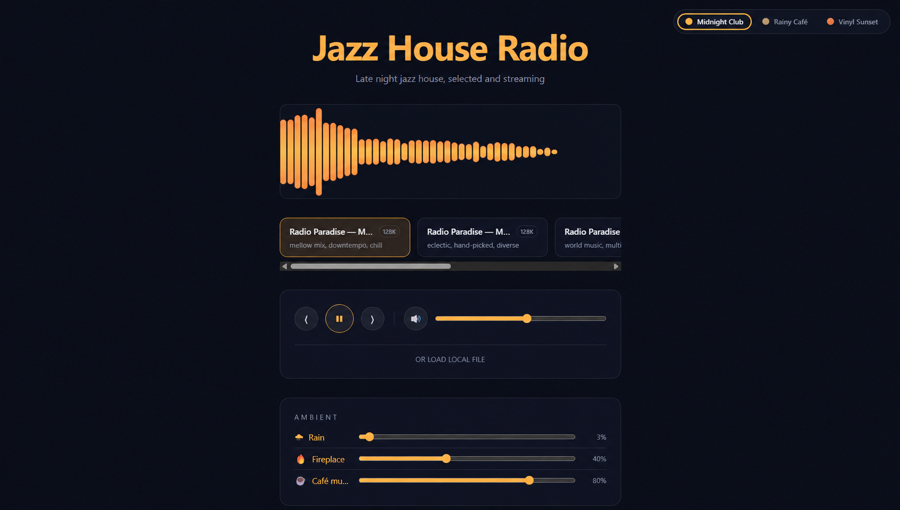

# Jazz House Radio 🎧

> A lo-fi radio player with a reactive visualizer and ambient mixer — all client-side, built with React 19 + Web Audio API.

**🎵 [Live demo](https://jazz-house-radio.vercel.app)**

 *(placeholder — se agrega al final)*

## Features

- Streaming de 5 estaciones curadas (Radio Paradise channels) con auto-skip ante fallas de red o CORS.
- Reproducción de archivos locales (`.mp3` / `.wav`) como alternativa.
- Visualizador de espectro en tiempo real a 60 FPS sobre canvas, sincronizado con el audio.
- Mezclador de ambiente de 3 canales sintetizados/sampleados:
  - **Rain**: pink noise + LFO de intensidad + truenos aleatorios con ráfagas de 1–3 strikes.
  - **Fireplace**: fondo constante + wood cracks variados con probabilidad de "big crack".
  - **Coffee**: sample real loop de ambiente de café (clinks, tenedores, murmullo).
- 3 temas visuales intercambiables con persistencia en `localStorage` (Midnight Club / Rainy Café / Vinyl Sunset).
- Controles: play/pause, mute, volumen por canal (radio + 3 ambient), navegación de estaciones (prev/next + atajos).
- Grafo de audio diseñado para que el ambiente **no contamine** el analyser del visualizador: las barras reaccionan solo a la música.

## Tech stack

- **Framework:** React 19 + TypeScript
- **Bundler:** Vite 9
- **Styling:** Tailwind CSS v4 (plugin oficial de Vite, sin `tailwind.config`)
- **Audio:** Web Audio API nativa (`AudioContext`, `AnalyserNode`, `GainNode`, `AudioBufferSourceNode`, `BiquadFilterNode`, `OscillatorNode`)
- **Gráficos:** HTML5 Canvas 2D + `requestAnimationFrame`
- **Fuentes de streams:** Radio Paradise

## Run locally

Standard Vite. `npm install && npm run dev`. The ambient mixer needs a `.mp3` at `public/sounds/coffee-ambience.mp3` — any café ambience loop works.

## Architecture highlights

El motor de audio vive en `src/audio/` como un hook (`useAudioEngine`) que mantiene el grafo de Web Audio en `useRef` — **fuera del ciclo de render de React**. La UI declarativa se limita a dispararle acciones (play, loadStream, setVolume); nunca pasa muestras de audio por `useState`.

### Grafo

```
                                   ┌─ rainGain ─────┐
<audio> radio                      │                │
   │                               ├─ fireGain ─────┤
   ▼                               │                │
MediaElementSource                 └─ coffeeGain ───┘
   │                                       │
   ▼                                       │
radioGain ──► analyser ──► masterGain ◄────┘
                              │
                              ▼
                          destination
```

- El `analyser` solo "escucha" la radio → el espectro reacciona a la música, nunca al ambiente.
- `radioGain` lo controla el slider "Radio" del Player.
- `masterGain` queda dedicado al mute (silencia todo sin tocar niveles individuales).
- Los canales de ambiente se suman **después** del analyser, directamente a `masterGain`.

### Patrones descubiertos durante la implementación

- **Mirror refs**: cualquier state de React que un callback con `[]` deps necesite leer (como `volume` o `isMuted`) se duplica en un `useRef` paralelo. Sin eso la callback cierra sobre el valor inicial y lee uno stale.
- **Cleanup de `<audio>` streaming**: pausar el elemento no cierra el buffer de red. Para liberar la conexión hay que hacer `removeAttribute('src')` + `.load()` antes del `disconnect` del `MediaElementSource` y el `close()` del context.
- **Canvas 2D + DPR**: reasignar `canvas.width/height` resetea TODO el context state (matriz, estilos). El visualizador usa `setTransform(dpr, 0, 0, dpr, 0, 0)` para recomponer tras cada resize y lee variables CSS (`--accent`, `--accent-2`) cada frame, lo que permite cambiar de tema sin reiniciar el loop.
- **`createMediaElementSource` una sola vez por `<audio>`**: cambiar de estación reasigna `el.src`, nunca el nodo source. Un grafo construido en el primer gesto del usuario, inmutable después.

Ver `CLAUDE.md` para el detalle completo y las trampas específicas de Web Audio (autoplay policy, CORS, limpieza de memoria).

## Credits

- Radio streams: [Radio Paradise](https://radioparadise.com/) (5 channels used with respect to their service).
- Coffee ambience sample: [Pixabay](https://pixabay.com/) (royalty-free).
- Rain, fireplace y thunder: 100% síntesis con Web Audio API (pink/brown noise, Paul Kellet's pink noise algorithm, scheduled noise bursts con envelopes gaussianos/exponenciales).

## License

MIT

---

[](https://jazz-house-radio.vercel.app)

---

Built by Ezequiel Morgado — 2026
